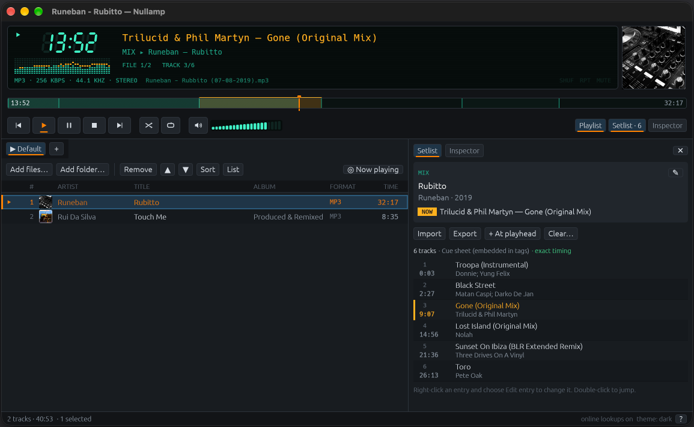

# Nullamp user manual

Version 0.2. This manual covers the macOS app. For building from source and the project layout, see the [README](../README.md).

  

## Contents

1. [What Nullamp is](#1-what-nullamp-is)
2. [Getting started](#2-getting-started)
3. [A tour of the window](#3-a-tour-of-the-window)
4. [Playing music](#4-playing-music)
5. [Playlists](#5-playlists)
6. [DJ mixes and setlists](#6-dj-mixes-and-setlists)
7. [Editing tags and artwork](#7-editing-tags-and-artwork)
8. [Online lookups](#8-online-lookups)
9. [Keyboard shortcuts](#9-keyboard-shortcuts)
10. [Where Nullamp keeps your data](#10-where-nullamp-keeps-your-data)
11. [Troubleshooting](#11-troubleshooting)
12. [Known limitations](#12-known-limitations)

## 1. What Nullamp is

Nullamp plays the music files on your disk. It is built for two things:

- **Fast, plain playback.** Files open in a few tens of milliseconds, seeking is instant, and nothing you do blocks the window.
- **DJ mixes.** A mix is one long audio file that contains many tracks. Nullamp reads the track list (the *setlist*) and always shows which track is playing right now.

It also has a metadata editor for tags and artwork that edits files safely.

Nullamp is not a streaming service and not a library manager. It never moves, renames or scans your music folders on its own.

**Supported formats:** MP3, AAC and M4A, ALAC, FLAC, Ogg Vorbis, WAV and AIFF.

## 2. Getting started

### Install

1. Download the latest `Nullamp` zip from the [Releases](https://github.com/jbrunemann/nullamp/releases) page and unzip it.
2. Drag `Nullamp.app` to your Applications folder.
3. The app is not signed or notarised yet. The first time, right-click `Nullamp.app`, choose **Open**, and confirm.

### Add music

Do any of the following:

- Drag files or folders from Finder onto the window. They land where you drop them.
- Click **Add files…** (⌘O) or **Add folder…** (⇧⌘O) above the playlist.
- Use **List ▸ Import M3U / M3U8…** to load an existing playlist.

Double-click a row, or select it and press Enter, to play it.

## 3. A tour of the window

The window has four areas, from top to bottom. The numbers refer to the screenshot at the top of this manual.

### The deck

The black display at the top is the *LCD*.

| Element | What it shows |
|---|---|
| Large green digits | Elapsed time in the current track. Click them to switch between elapsed and remaining time. |
| Spectrum below the digits | A live visualiser. Click it to cycle between spectrum, oscilloscope and off. The picture is aligned to what you hear, not to what was just decoded. |
| Orange title | The track that is playing. For a mix, this is the track *inside* the mix. |
| Green line under it | For a mix: `MIX ▸ mix title, DJ`. For a single track: artist and album. |
| `FILE 1/2   TRACK 3/6` | Position in the playlist, and for a mix the position in the setlist. |
| Bottom line | Format, bit rate, sample rate, channels and the file name. Hover the file name for the full path. |
| `SHUF  RPT  MUTE` | Lit when shuffle, repeat or mute is on. |
| Square at the right | Artwork. For a mix it switches to the artwork of the current setlist entry when there is one. Click it to open the Inspector. |

### The timeline

Under the LCD is the seek bar. Click or drag to seek.

When the playing file is a mix, the timeline is divided into one segment per setlist entry. Thin vertical lines mark the track boundaries and the current track is lit in amber. Solid boundaries are exact. Dashed boundaries are estimates (see [Approximate times](#approximate-times)). Hover a segment to see the track name and its start time. The numbers at the ends are elapsed and total time.

### The transport

| Control | Action |
|---|---|
| ⏮ ⏵ ⏸ ⏹ ⏭ | Previous, play, pause, stop, next |
| Shuffle | Toggle shuffle |
| Repeat | Cycle repeat modes |
| Speaker and green bars | Mute, and volume. Click the bars or scroll over them. |
| **Playlist**, **Setlist**, **Inspector** | Show or hide the playlist and the two side panels |

The **Setlist** button carries the number of entries (`Setlist · 6`). It only appears for a mix.

### Playlist and side panel

The left area holds your playlists. The right area is the side panel, which shows either the **Setlist** or the **Inspector**. Drag the divider between them to resize. The `×` closes the side panel.

The status bar at the bottom shows track counts and total time, messages, whether online lookups are on, the theme, and a `?` button for the shortcut list.

## 4. Playing music

- **Play, pause, stop, previous, next:** the transport buttons, or Space (play and pause), and Z X C V B. See [Keyboard shortcuts](#9-keyboard-shortcuts).
- **Seek:** click or drag the timeline (the seek happens when you let go), or press ← and → to move 5 seconds.
- **Volume:** the green bars, or + and −. M mutes.
- **Shuffle and repeat:** S and R, or the buttons.
- **Gapless:** the next track is prepared while the current one plays, so albums and consecutive mixes play without a gap.
- **Media keys:** the hardware play, pause and skip keys work even while Nullamp is in the background. The macOS Now Playing widget shows the current track. For a mix, it shows the track inside the mix as the title and "mix title, DJ" as the album.
- **Output device changes:** if you plug in headphones, connect Bluetooth speakers, or wake the Mac from sleep, Nullamp recovers and continues from the same position.
- **Resume:** by default Nullamp starts silent. It does not resume the last track unless the `resume_playback` setting is on (see [Settings](#settings-file)).

### Themes

Click **theme:** in the status bar to cycle through dark, light and system. The LCD stays dark in every theme. The choice is remembered.

## 5. Playlists

### Tabs

Each playlist is a tab. The tab with a `▶` is the one that is playing.

- **+** creates a playlist.
- Double-click a tab to rename it.
- Right-click a tab for **Rename…**, **Export as M3U8…** and **Delete playlist…**.

Playlists are saved automatically and are restored the next time you start Nullamp. A playlist holds *references* to your files. Deleting a playlist never deletes audio.

### The table

| Action | How |
|---|---|
| Select | Click. ⇧-click or ⇧↑/⇧↓ extends, ⌘A selects all. |
| Play | Double-click, or Enter |
| Reorder | Drag rows. A line shows where they will land. Or use **▲ ▼**, or ⌥↑ and ⌥↓. |
| Remove | **Remove**, or Delete or Backspace |
| Right-click menu | **Play**, **Inspect metadata**, **Show in folder**, **Copy path**, **Move up**, **Move down**, **Remove** |
| Find the playing track | **◎ Now playing**, or ⌘J |

Missing files stay in the list, greyed out with a warning, so you can find and fix them. **List ▸ Remove unavailable entries** removes them all.

Columns: right-click the header to show or hide columns, drag a header to reorder them, and choose **Reset columns** to go back to the default. A column shows the track number, a small artwork thumbnail with the artist, the title, the album, the format and the duration.

### Toolbar menus

- **Sort:** by title, artist, album, file path or duration, and **Reverse**.
- **List:** import or export M3U/M3U8, select all, remove unavailable entries, **Rescan tags** (re-read tags for every entry), and **Clear playlist…**.

### Hiding the playlist

Click **Playlist** (or press ⌘P) to hide the table. With the side panel closed too, the window shrinks to just the player and the status bar. It restores its size when you bring the playlist back.

## 6. DJ mixes and setlists

A **setlist** is the list of tracks inside one long file, each with a start time. Nullamp keeps setlists per audio file, and they never alter the audio.

### How Nullamp finds a setlist

When a file is loaded, Nullamp looks for a track list in this order and uses the first one it finds:

1. A cue sheet next to the audio with exactly the same name (`mix.mp3` and `mix.cue`).
2. ID3 chapters embedded in the file (MP3, WAV and AIFF).
3. A cue sheet stored inside a tag, such as a CUESHEET item or a comment that contains a cue sheet. The screenshot at the top shows this case: the panel says "Cue sheet (embedded in tags) · exact timing".
4. Any other cue sheet in the same folder that refers to the file.
5. A plain numbered list in the comment or description tag. This has no times, so it is shown as a reference list only.

Cue sheets from rekordbox, where INDEX times are written as `hh:mm:ss`, are understood.

A file counts as a mix when it has a setlist of at least two entries, or when it is longer than 20 minutes, or when you create a setlist for it. For single tracks the Setlist button and the mix lines on the LCD stay hidden, and the Inspector is shown instead. Press ⌘L on a single track if you do want to add a setlist.

### Reading the setlist panel

Open **Setlist** in the side panel.

- The top card shows `MIX`, the mix title, DJ and year, and the track that is playing (`NOW`). The ✎ button edits the mix information. It does not touch the file's tags.
- A line below the buttons tells you how many tracks there are, where the list came from, and whether the timing is exact or approximate.
- The list shows each entry's number, start time, title and artist. The current entry is highlighted in amber.
- Any problem, such as entries out of order or beyond the end of the file, is listed above the entries.

**Double-click** an entry to jump to it. Press ⇧← and ⇧→ to go to the previous or next entry while listening.

### Correcting a setlist

Right-click an entry for **Edit entry**, **Set start to playhead** and **Delete entry**. In the editor you can change the title and artist, type a time, or press **→ playhead** to use the current playback position. The **exact** checkbox says whether the time is trustworthy.

To fix a time by ear: play to the moment the new track starts, right-click that entry, and choose **Set start to playhead**. The boundary becomes exact.

To add a missing track, play to where it starts and click **+ At playhead**.

**Look up…** in the entry editor searches MusicBrainz for release information and artwork (see [Online lookups](#8-online-lookups)).

Your corrections are saved with the setlist. They survive renaming, moving or retagging the audio file, because Nullamp identifies the audio by a fingerprint of its content, not by its name. **Import ▸ Scan file again** re-reads the file's chapters and cue sheets while keeping your corrections.

### Importing a setlist

Click **Import**:

- **Cue sheet or text file…** reads a `.cue` file or a text tracklist.
- **Paste tracklist…** parses a list you copied from a web page, a video description or a comment. Timestamps like `12:34` or `1:02:03` are recognised, as are numbered lines and `Artist - Title` pairs. You can keep the page address as the *source*.
- **Scan file again** as described above.

Websites such as 1001Tracklists and mixid.fm do not offer a public interface, and Nullamp does not scrape them. Open the page in your browser, copy the list, and use **Paste tracklist…**.

#### Approximate times

Lists copied from the web often have times that are only roughly right. Those entries are marked with **≈** and their boundaries are dashed on the timeline. Correct them as described above and they become exact.

### Exporting a setlist

Click **Export**:

- **Cue sheet…** writes a `.cue` file.
- **Text tracklist…** writes a plain text list with timestamps.
- **Copy as text** puts the list on the clipboard.
- **Write as MP3 chapters…** stores the setlist inside the MP3 itself as ID3 chapters, so other players can see it. This replaces any chapters already in the file. Other tags and the audio are kept, and a backup is made if backups are on.

**Clear…** removes all entries for the file, including your corrections. It asks first.

## 7. Editing tags and artwork

Open the **Inspector** (the button, or ⌘I). It shows the selected file in the playlist. Tick **Follow playing track** to make it show whatever is playing instead.

### Fields

Title, artist, album, album artist, date, genre, track and disc numbers, composer, comment, description, copyright, and the artist and file URLs. Change what you like and press **Save**. **Cancel** discards your edits, and **Reload** reads the file again.

### Several files at once

Select up to 500 files and open the Inspector. A field that differs between the files shows `‹multiple values›`. Only the fields you touch are written, so you can set the album on a whole folder without changing anything else.

### Artwork

The artwork section shows every embedded image with its type, size and weight. **Import…** adds an image, **Remove** deletes one, and **Front** makes an image the front cover. With several files selected, changing artwork changes it in all of them.

### Read-only information

Below the fields you will find:

- **Technical**: format, bit rate, sample rate, channels, duration.
- **Embedded chapters** and **Cue sheet in tags**, if the file has them.
- **Other tag items**: frames Nullamp does not edit. They are preserved when saving.

### Safe saving

Nullamp never edits your file in place. Each save:

1. Checks that the file did not change on disk since you opened it.
2. Writes the new tags into a hidden copy.
3. Reads the copy back and checks the tags, the duration and the sample rate.
4. Optionally keeps a backup of the original.
5. Swaps the copy in atomically.

If anything fails, your original is untouched. Chapters, artwork you did not change, and unknown frames survive. The audio itself is never rewritten. After a save you can click **Restore it** to put the previous version back from the backup.

Backups are on by default. They are stored in the data folder (see [section 10](#10-where-nullamp-keeps-your-data)), with a size budget of 2 GB by default. The oldest backups go first.

## 8. Online lookups

Everything in Nullamp works offline. Two optional lookups use the internet:

- **MusicBrainz** finds recordings and releases by artist and title.
- **Cover Art Archive** supplies artwork for a release.

Use them from the Inspector under **Find metadata online**: type artist and title, press **Search**, then **Use** to fill the fields from a result (nothing is written until you press **Save**), or **Artwork** to fetch a cover. In the setlist, **Look up…** in the entry editor does the same for a single entry.

The status bar shows `online lookups on` or `offline mode`. Click it to switch. Nothing is sent while it is off. Only artist and title text is ever sent. Your audio is never uploaded.

## 9. Keyboard shortcuts

Press F1 or click `?` in the status bar to see this list in the app.

| Key | Action |
|---|---|
| Space or C | Play or pause |
| X | Play |
| V | Stop |
| Z or B | Previous or next track |
| ← or → | Seek 5 seconds |
| ⇧← or ⇧→ | Previous or next setlist entry |
| + or − | Volume up or down |
| M | Mute |
| S | Shuffle |
| R | Cycle repeat |
| ↑ ↓, Home, End | Move the selection (⇧ extends it) |
| Enter | Play the selected entry |
| Delete or Backspace | Remove the selected entries |
| ⌥↑ or ⌥↓ | Move the selected entries |
| ⌘A | Select all |
| ⌘O | Add files |
| ⇧⌘O | Add folder |
| ⌘I | Inspector |
| ⌘L | Setlist |
| ⌘P | Show or hide the playlist |
| ⌘J | Scroll to the playing track |
| F1 | Keyboard shortcuts |

The letter keys do not fire while you type in a text field.

## 10. Where Nullamp keeps your data

| What | Where |
|---|---|
| Settings, playlists, saved setlists | `~/Library/Application Support/Nullamp/` |
| Tag-write backups | `~/Library/Application Support/Nullamp/tag-backups/` |
| Online responses and artwork | `~/Library/Caches/Nullamp/`. Safe to delete. |

Set the environment variable `NULLAMP_HOME` to a folder before launching to keep everything in one place, for example on a USB stick or for testing: `NULLAMP_HOME=/some/dir open -a Nullamp`.

If a data file cannot be read, Nullamp renames it to `.broken`, tells you, and starts fresh with that file.

### Settings file

Nullamp writes `settings.json` in the config folder. Quit the app before editing it by hand. Useful keys:

| Key | Meaning |
|---|---|
| `resume_playback` | Resume the last track at start. Default off. |
| `backup_before_tag_writes` | Keep a backup on every tag write. Default on. |
| `backup_budget_mb` | Size budget for backups. Default 2048. |
| `online_lookups` | The status bar toggle. Default on. |
| `appearance` | `dark`, `light` or `system`. |
| `visualizer` | `spectrum`, `scope` or `off`. |

## 11. Troubleshooting

**The first launch says the app cannot be opened.** The app is unsigned. Right-click it, choose **Open**, and confirm once.

**No sound, or sound on the wrong device.** Nullamp plays to the current macOS output device. Change it in System Settings ▸ Sound. Nullamp follows the change within a moment.

**A file is greyed out with a warning.** The file moved or its volume is not mounted. Reconnect the volume, or remove the entry.

**A mix shows no setlist.** The file has no chapters or cue sheet that Nullamp could find. Put a `.cue` file next to it with exactly the same name, or use **Import ▸ Paste tracklist…**, or add entries yourself with **+ At playhead**.

**Times in a mix are a little off.** Seek to the true start, then use **Set start to playhead** on that entry.

**"Changed on disk" when saving tags.** Another program modified the file after you opened it. Press **Reload**, then redo your edit.

**A save went wrong.** Press **Restore it** right after saving, or find the original in the tag-backups folder.

**Lookups do nothing.** The status bar says `offline mode`. Click it to turn lookups on.

## 12. Known limitations

- Seeking far into a variable bit rate MP3 that has no seek table is approximate. Constant bit rate files, which covers most DJ mixes, seek exactly.
- The setlist panel follows the file that is playing. You cannot edit the setlist of a file that is not playing.
- Batch tag editing is limited to 500 files.
- Online search for tracklists is not part of the app. Use paste import.
- "Open with Nullamp" from Finder is not wired up yet. Drag files onto the window instead.
- macOS is the only supported platform for now.
